# Compy

Compy is a compiler you can watch. You type a C program and the tool shows you every
stage a real compiler takes it through: the characters becoming tokens, the tokens becoming
a syntax tree, the tree acquiring types, the typed tree lowered into an intermediate
representation, that IR being optimized pass by pass, and finally RISC-V assembly, which you
can run one instruction at a time while the register file and the process memory change in
front of you. It runs entirely in the browser. There is no server and no WebAssembly port of
an existing compiler: the whole toolchain, from the preprocessor to the register allocator to
the machine simulator, is code written for this tool so that every intermediate result is
available to draw.

The second half of Compy is a language lab for the automata and parsing side of a compilers
or theory of computation course. You define your own tokens with regular expressions and your
own grammar in BNF, and the lab draws the NFA, the subset construction, the minimal DFA, the
FIRST and FOLLOW sets as they converge, the LR item sets and goto graph, the Earley chart, the
CYK table, the pushdown automaton, and the parse tree growing step by step under any of nine
parsers.

I built it because the hard part of a compilers course is not any single algorithm; it is
holding the whole pipeline in your head at once and believing that each stage really does what
the lecture says. A listing of LR items in a textbook is inert. The same items, highlighted in
the state the parser is currently in while the stack and the remaining input sit next to them,
are something you can argue with.

Live at https://compy.jyotiprakash.org

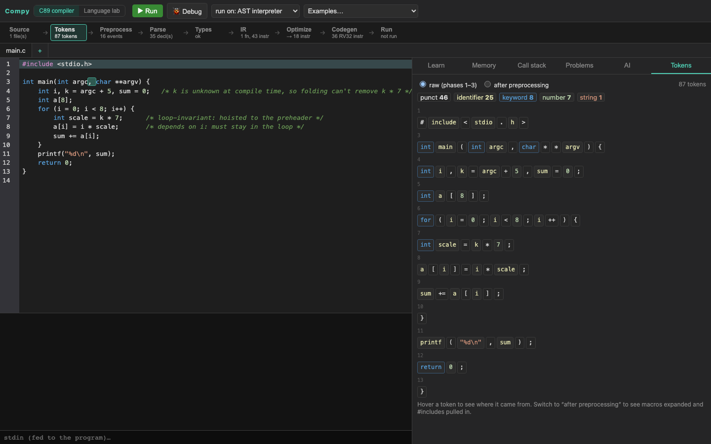

## Two modes

The switch in the toolbar picks between the two products that share the window.

**C89 compiler** is the fixed-language mode. The language is C89 with a few friendly extras,
the target is 32-bit RISC-V, and the phase bar across the top reads Source, Tokens,
Preprocess, Parse, Types, IR, Optimize, Codegen, Run. Each phase is a panel; clicking a phase
opens it. The panels are live: they recompute as you type, so the IR and the assembly keep up
with the program.

**Language lab** is the open-language mode. There is no fixed language and no code generation.
You write lexical rules, a grammar, and an input string, choose a parser, and step. Everything
the lab computes is drawn.

The two modes keep separate projects, so switching between them never loses work.

## The compiler, phase by phase

### Tokens

The lexer runs the first three translation phases of the C standard: line splicing, comment
removal, and tokenization with maximal munch. The Tokens panel shows the stream for the current
file, colour coded by kind, with per-kind counts at the top. Hovering a token lights up the
exact characters it came from in the editor. A second view shows the stream after
preprocessing, where macro-produced tokens are marked and tokens pulled in from headers are
dimmed, so you can see what the parser will actually consume.

### Preprocess

The preprocessor is complete: object-like and function-like macros with `#` and `##`, the
whole `#if` family with a constant-expression evaluator, `#include` over a virtual filesystem
that holds the thirteen standard headers, and the predefined macros. The panel is a lens over
it: every define, expansion, include, and conditional is listed with the line it happened on,
and the output stream below it is the preprocessed program with provenance.

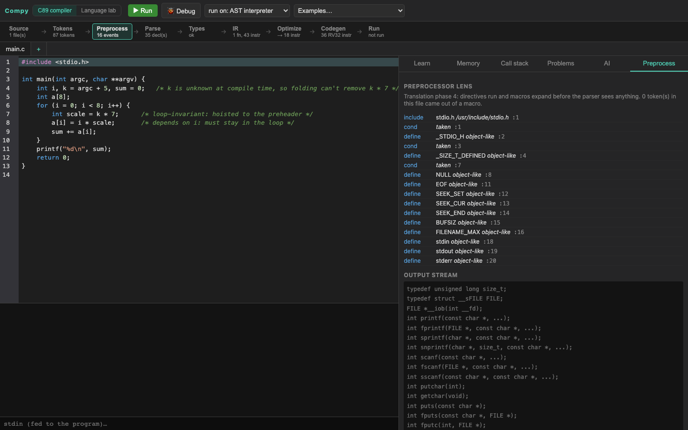

### Parse

The parser is a hand-written recursive-descent parser for all of C89, including the
declarator syntax that students find hardest. The panel shows the abstract syntax tree as a
collapsible outline. Every node carries its source span, so hovering a node highlights the text
it covers and clicking it jumps the editor there. With the types option on, each expression
node is annotated with the type that semantic analysis assigned to it, and each identifier use
links to the line of its declaration. Declarators nest from the identifier outward, which makes
`int (*fp)(int)` versus `int *fp(int)` visible as two different tree shapes.

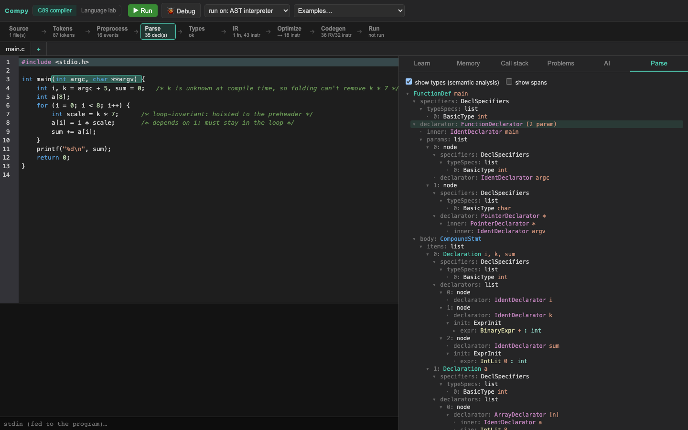

### Types

Semantic analysis builds a symbol table with scopes, resolves every name, assigns a type to
every expression following the usual arithmetic conversions, and lays out structs and unions
with the ILP32 model (`int`, `long`, and pointers are four bytes). The Types panel lists every
symbol with its kind, resolved type, size, alignment, linkage, and declaration line, draws every
struct layout as a bar with padding shown in hatched cells, and lists the diagnostics the
analyzer raised.

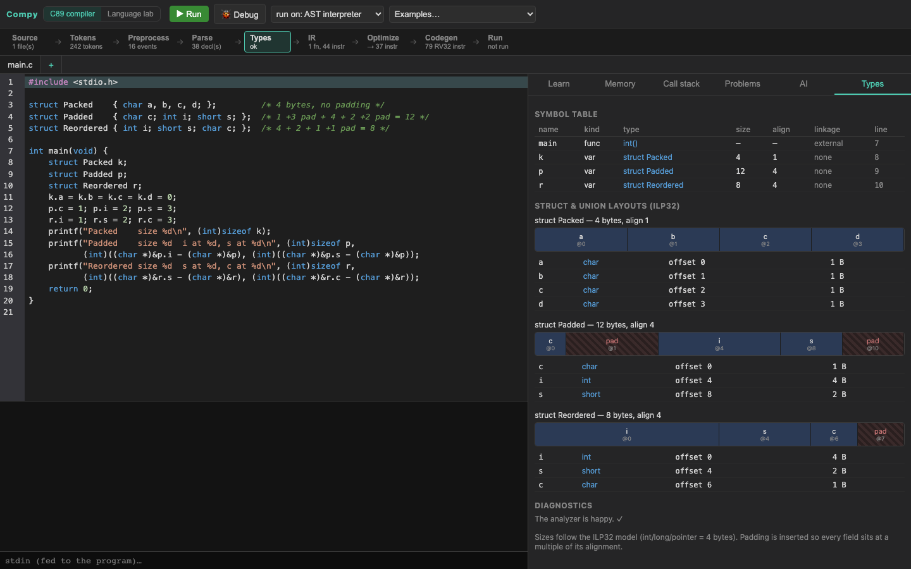

### IR

Lowering turns the typed tree into a typed three-address intermediate representation in the
style of LLVM: functions made of basic blocks, each ending in exactly one terminator, with
integer types that carry only a width (signedness lives in the operation), comparisons that
produce an `i1`, and locals that start life as `alloca` stack slots with explicit loads and
stores. That last choice is deliberate. It is what a real compiler emits at `-O0`, and it gives
the optimizer visible work to do.

The IR panel shows the lowered module as text, with every instruction linked to the source line
it came from, or as a control-flow graph with the basic blocks drawn as boxes and the edges
labelled true, false, or back edge. A stepper runs the IR interpreter and replays it
instruction by instruction with the registers of the current frame.

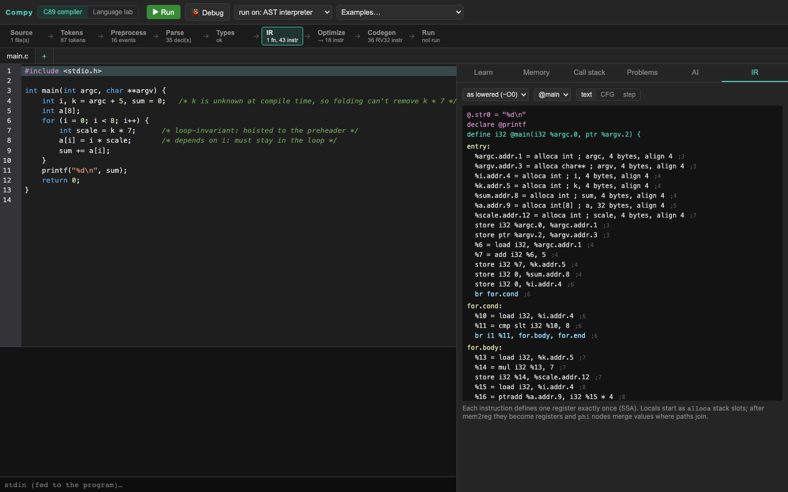

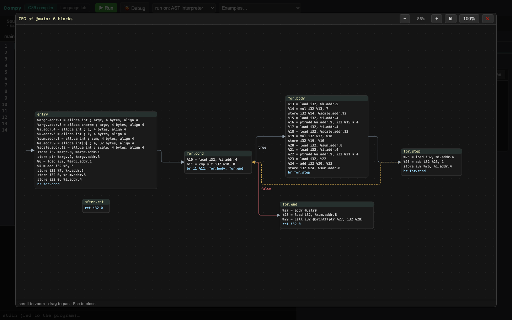

### Optimize

Eight passes, each of which you can switch off: simplify-CFG, promotion of memory to
registers (SSA construction with phi nodes), inlining, constant folding and propagation,
algebraic simplification with strength reduction, common-subexpression elimination over the
dominator tree, dead code elimination, and loop-invariant code motion with preheader insertion.
The panel explains each pass in a paragraph, lists what happened in the order it happened, and
shows a line diff of every function a pass changed. The instruction count before and after is
on the toolbar.

The passes are checked the way the rest of the toolchain is: each pass alone, and the full
pipeline, must leave the output of every test program unchanged.

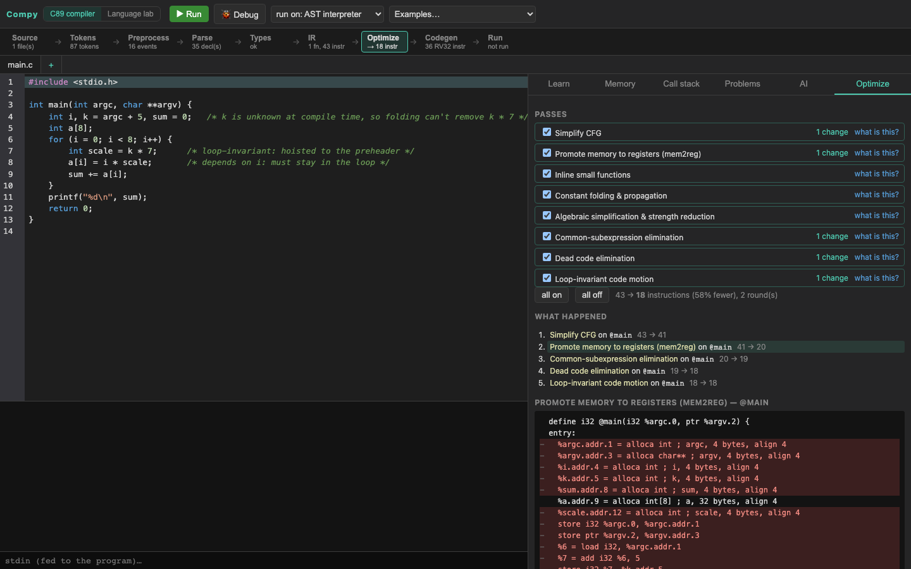

### Codegen

The back end targets RV32IM with the F and D extensions. Instruction selection produces
RISC-V with virtual registers, fixes the calling convention (arguments in a0 to a7 and fa0 to
fa7, the rest on the stack, variadic doubles in integer register pairs), eliminates phi nodes
with copies on the incoming edges, fuses compares into branches, and handles 64-bit integers as
register pairs with the same helper routines a real rv32 toolchain links. Two register
allocators are available so that you can compare them: a naive one that spills every value to
the stack, and a linear-scan allocator with liveness analysis and call-aware register pools.

The panel shows the final listing with the source line of each group of instructions as a
comment, the listing before register allocation with the virtual registers still in it, a chart
of every virtual register's live interval and the physical register or stack slot it received,
and a machine stepper.

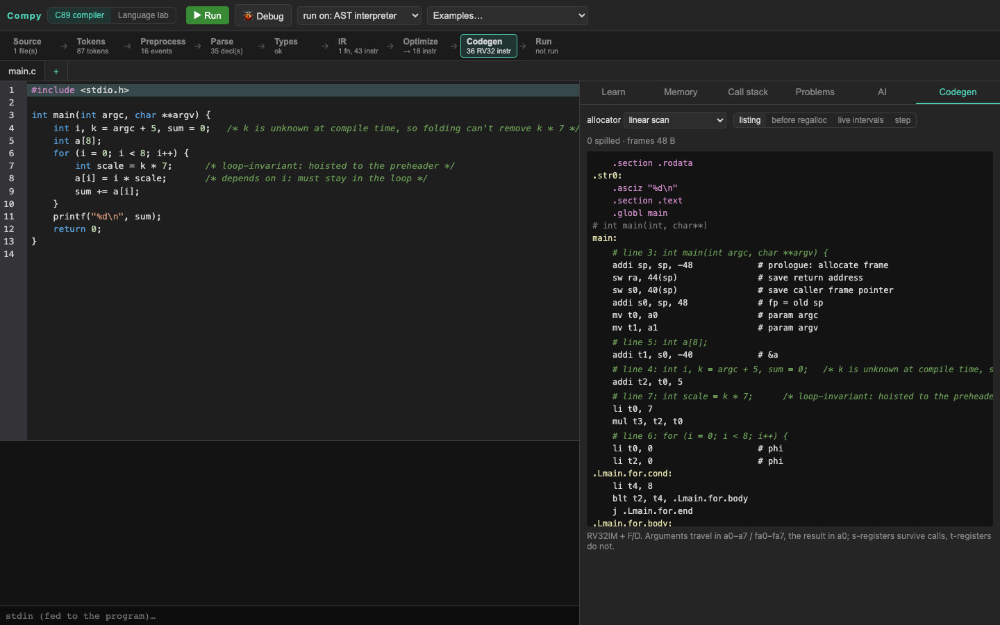

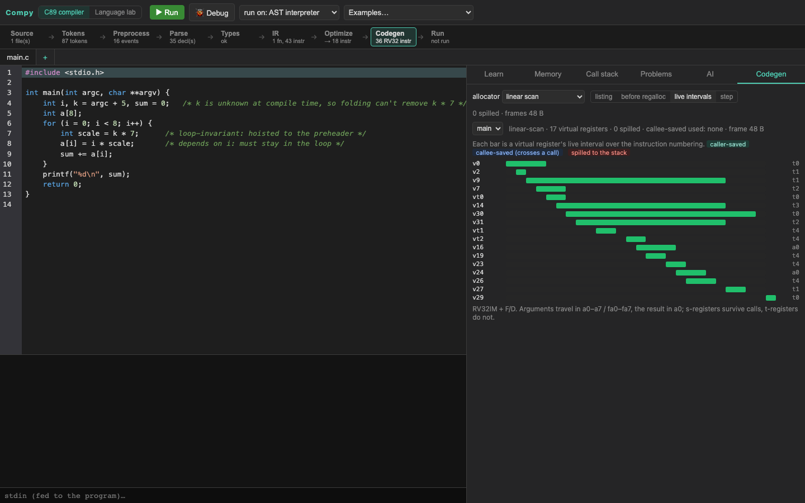

The machine stepper replays the simulator one instruction at a time. The current instruction is
highlighted, the integer and floating register files are shown, and the register the
instruction just changed is marked.

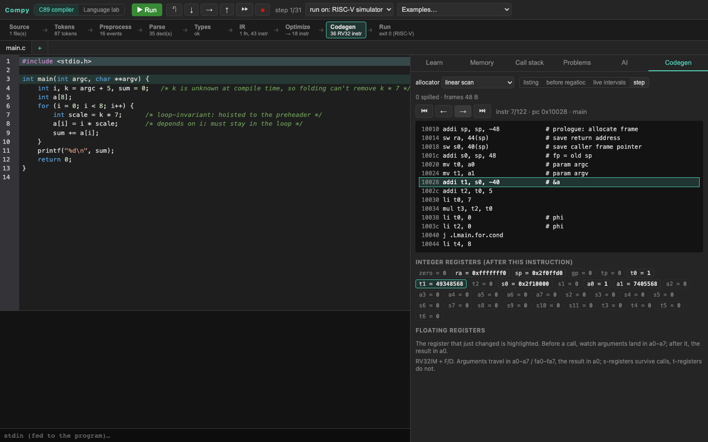

### Run

Three engines can execute the program, and they must agree: the tree-walking interpreter over
the typed AST, the IR interpreter, and the RISC-V simulator. All three run over the same
process memory model: one little-endian address space laid out like a real process, with a NULL
guard page, text, read-only data, initialized data, zero-initialized data, a heap that grows up,
and a stack that grows down. Every access is checked, so a null dereference, an out-of-bounds
access, a read of uninitialized memory, a use after free, a double free, a write to a string
literal, a stack overflow, and a leak are each caught and reported with the exact address, the
line, and a plain-English explanation instead of corrupting something silently.

The Memory panel shows the segments with their usage, the locals of the current frame and the
globals with their addresses and values, the heap blocks with their state, and a hex dump of any
region. The hex dump is editable: click a byte and change it, and the program sees the change.

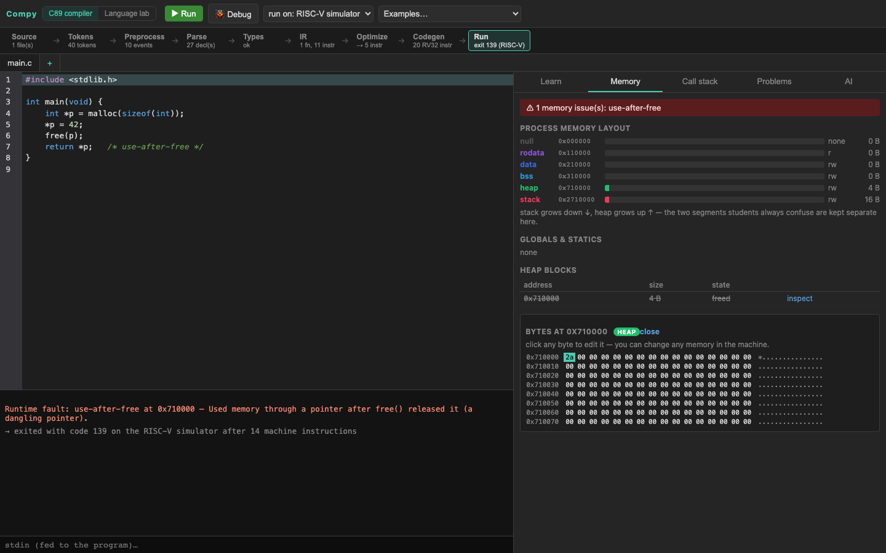

The debugger records the whole execution and lets you move through it in either direction:
step into, over, out, back, and continue to a breakpoint, with the call stack and the locals at
every point. It works on all three engines, so you can step the same program as an AST
interpretation and as RISC-V and compare.

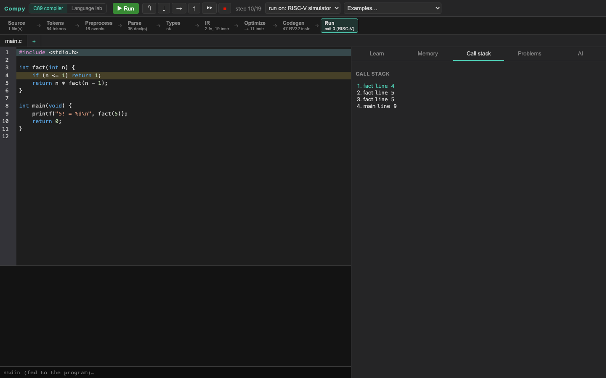

### Lessons

The Learn tab holds a short compilers course: thirty-two lessons from lexing through the
process memory model, each with a program chosen to make the lesson visible in a particular
panel and a list of things to try. The example menu also carries a library of programs grouped
by what they demonstrate, including deliberate bugs for the memory sandbox to catch.

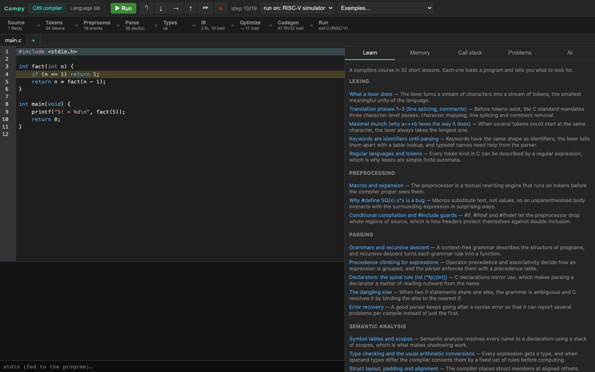

## The language lab

Switch to the language lab and the phase bar changes to Lexer spec, Automata, Tokens, Grammar,
Analysis, Parse, Tree. The project is three documents: `tokens.lex` with the lexical rules,
`grammar.cfg` with the grammar, and `input.txt`. A configuration strip chooses the lexer mode
and whether to stop at the lexer or continue into a parser.

### Lexical rules and automata

The rule file is in the style of a lexer generator: one rule per line with a name and a regular
expression, `skip:` rules for whitespace and comments, earlier rules winning ties, longest match
otherwise, and start conditions for contexts such as string literals. Each rule, or the whole
scanner, is compiled through Thompson's construction into an NFA, through the subset
construction into a DFA, and through Hopcroft's algorithm into the minimal DFA. All three are
drawn, the subset construction is shown as its table of state sets, and the minimization is
shown as the sequence of partitions. A tester animates either machine over a string you type.

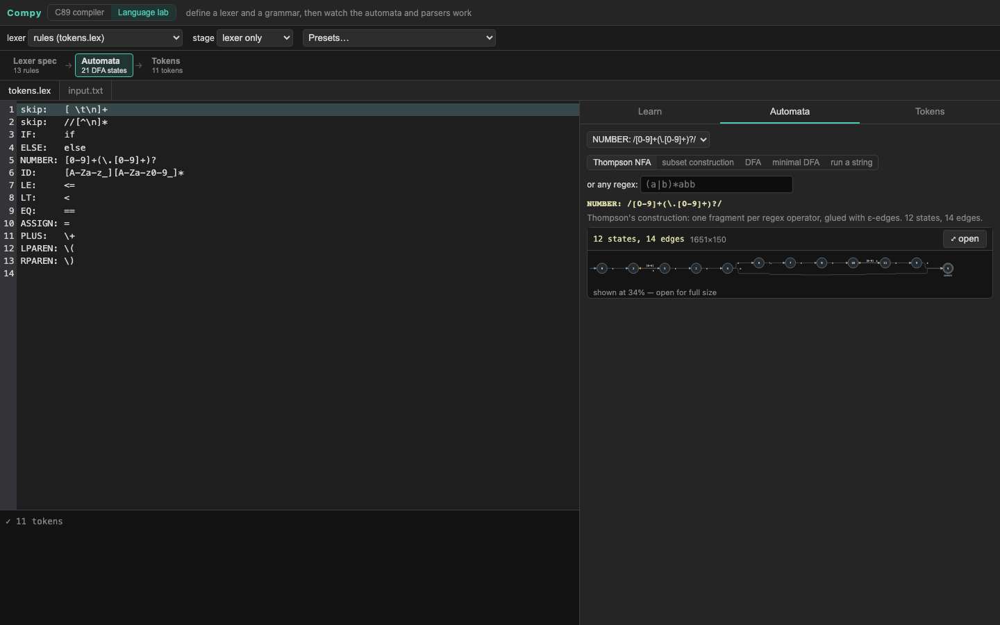

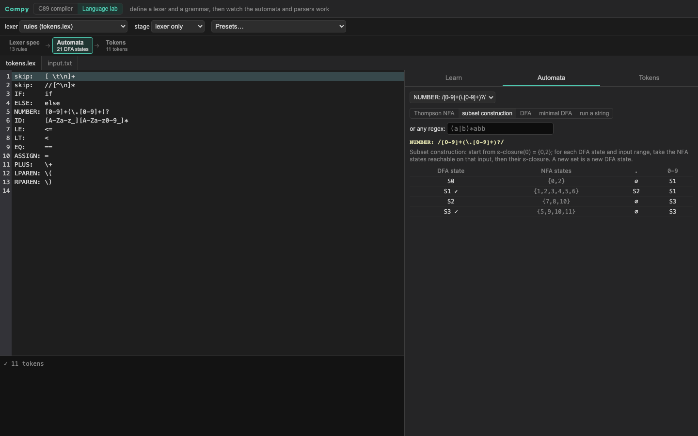

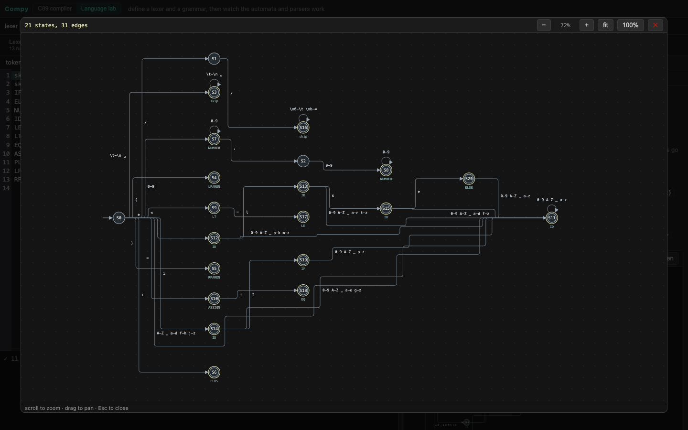

The Tokens panel shows the token stream and replays the scanner on the input as a tape: the
cursor runs ahead while transitions exist, the last accepting position is remembered, and when
the scanner gets stuck you watch it back up and emit the token. The scanner DFA next to it
lights up the current state.

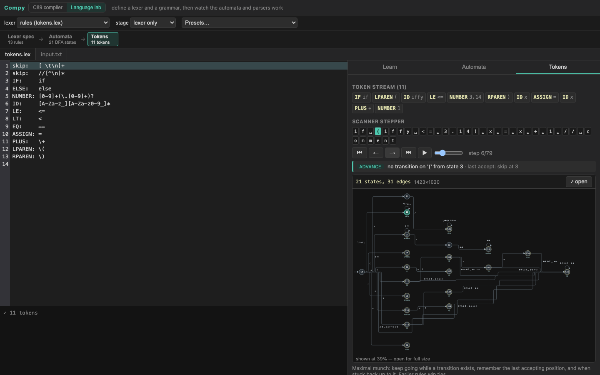

Two other lexer modes exist for theory courses. The character lexer makes every character its
own token, which is how you parse `aⁿbⁿ` or balanced parentheses without writing rules. The
given-tokens mode lets you paste a token sequence directly and skip lexing altogether.

### Grammars

The grammar is BNF with alternatives, epsilon, quoted literals that become keyword tokens
automatically, and optional precedence declarations. The Analysis panel computes nullable,
FIRST, and FOLLOW as fixpoints and lets you step through the iterations, with the entries added
in each iteration highlighted, so the dependency between the sets is something you watch
resolve rather than take on faith.

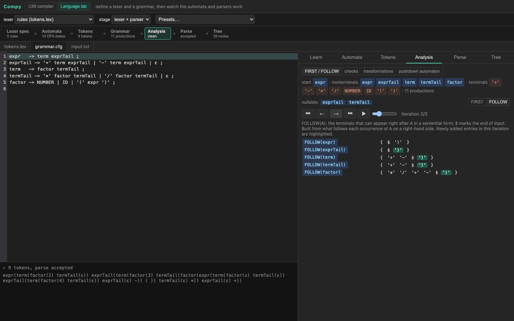

The checks tab reports left recursion, common prefixes, and unreachable or unproductive symbols,
says which parsers each problem blocks, and offers the fix. The transformations tab applies the
classic rewrites, each as a diff you can read before applying it: removal of epsilon, unit, and
useless productions, elimination of left recursion, left factoring, and conversion to Chomsky
normal form.

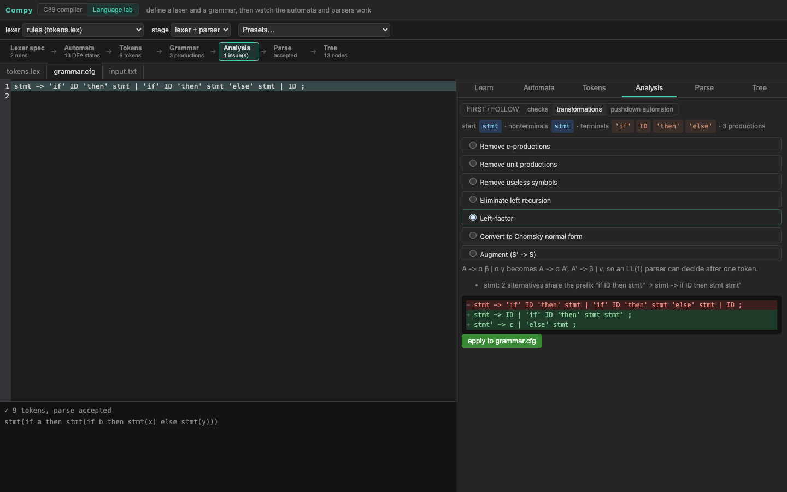

### Parsers

Nine parsers share one stepper, the same input cursor, and the same growing parse tree.

Recursive descent is generated from the grammar as pseudocode with the executing line
highlighted and a live call stack. LL(1) shows the predict table with the cell consulted at each
step. LR(0), SLR(1), canonical LR(1), and LALR(1) show the item sets, the goto graph drawn as
an automaton with the current state highlighted, and the ACTION and GOTO tables with conflicts
in red; the LALR view also shows which LR(1) states were merged, which is how the standard
example of a grammar that is LR(1) but not LALR(1) becomes concrete. Earley shows the chart
filling column by column and counts the parse trees of an ambiguous sentence. CYK shows the
triangle filling bottom up on the grammar's Chomsky normal form. The operator-precedence parser
uses the `%left`, `%right`, and `%nonassoc` declarations and shows both the recursive calls
with their minimum precedence and the equivalent operand and operator stacks.

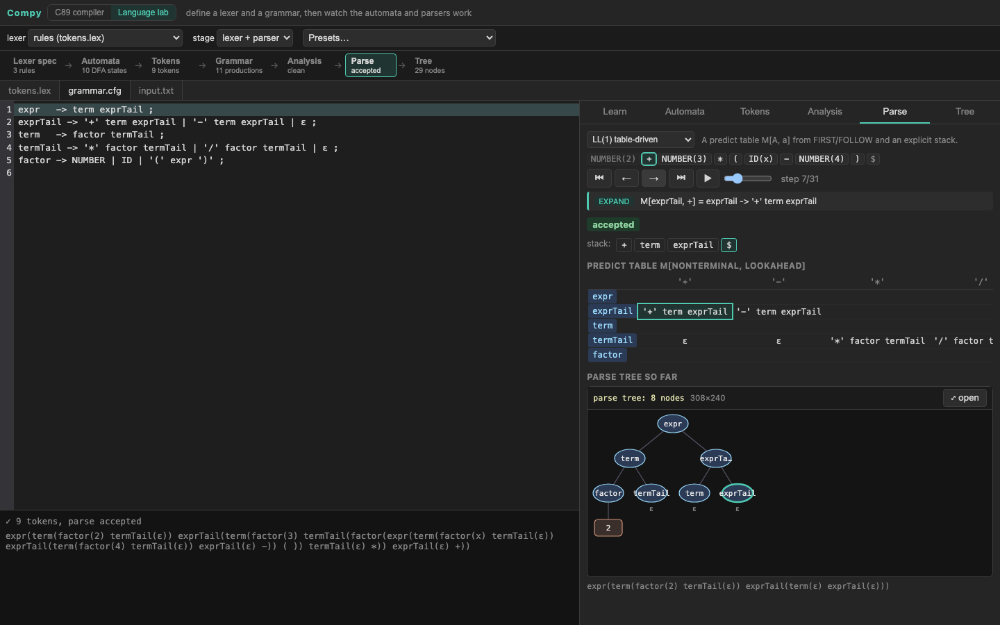

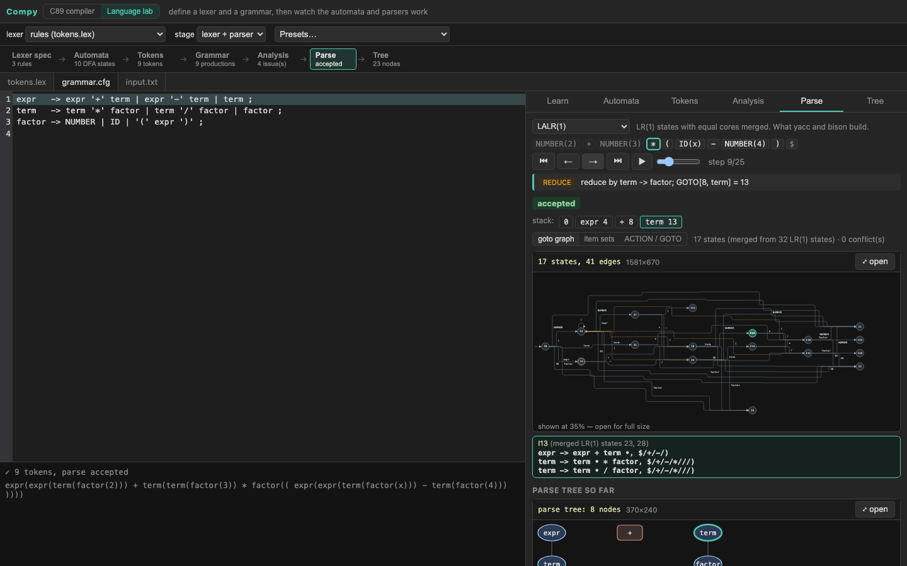

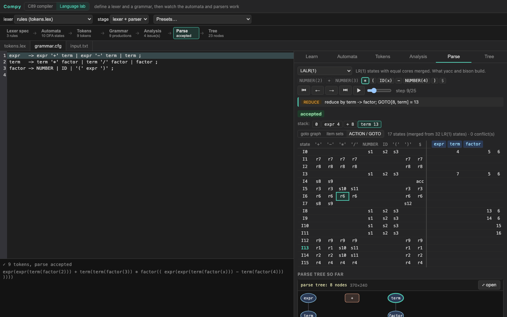

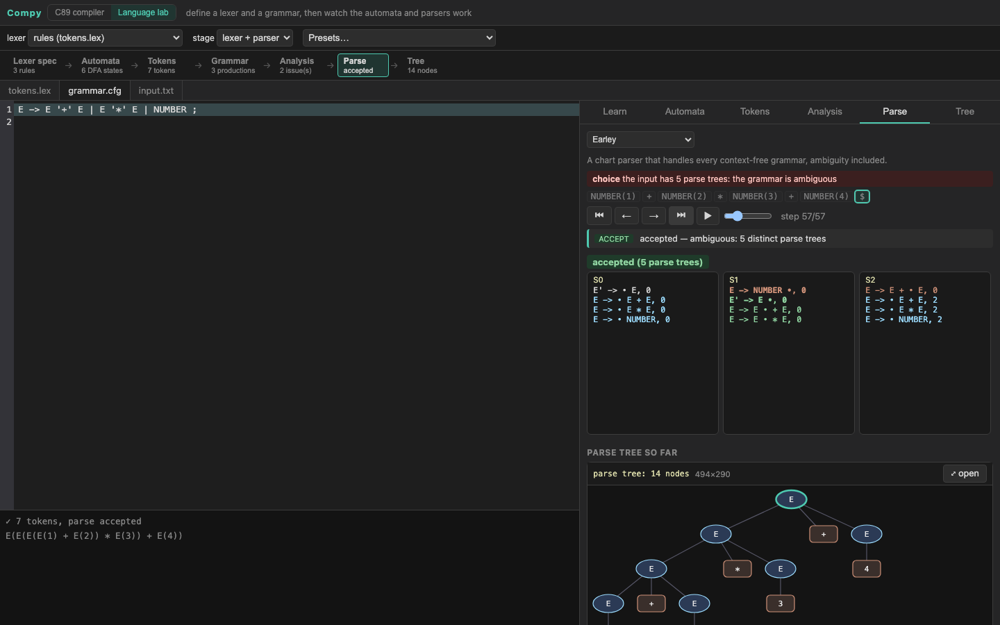

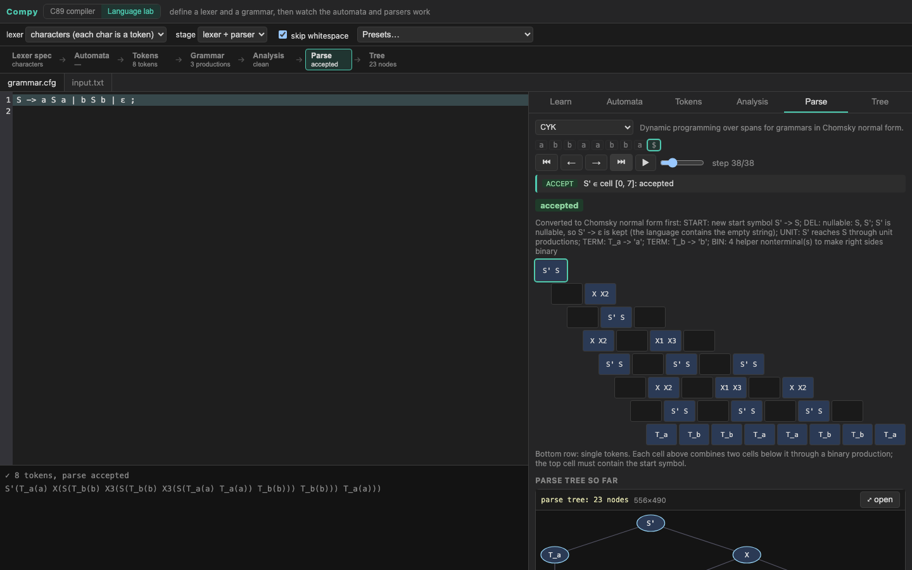

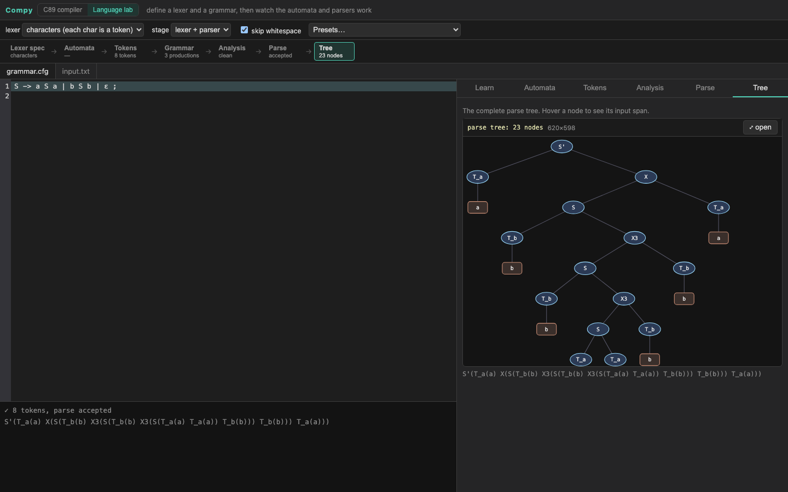

### Pushdown automaton

The grammar's pushdown automaton is built by the textbook construction and drawn with its
transition table. Because the construction is nondeterministic, the stepper simulates the set of
live configurations, each a state, the remaining input, and the stack, and highlights the ones
that lie on an accepting path.

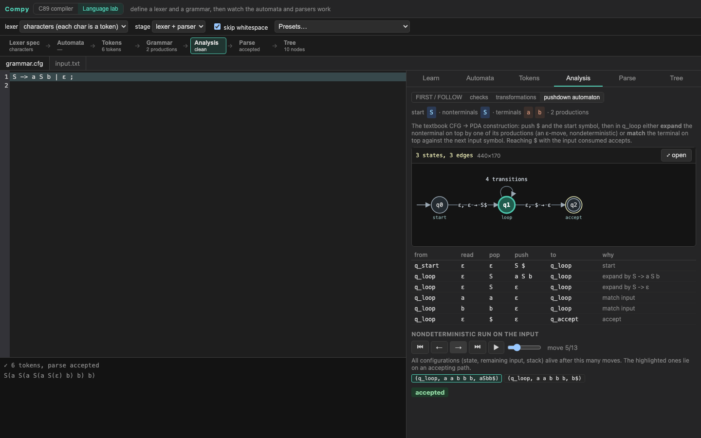

### Lessons

The lab has its own course of nineteen lessons, from regular expressions and Thompson's
construction to the LALR merge and the CFG-to-PDA construction. Each loads a preset and opens
the panel it talks about.

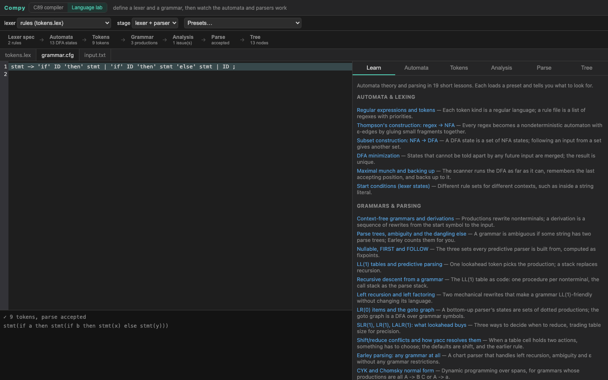

## Diagrams

Every graph in the tool is drawn by one layout engine with guarantees you can rely on while
reading: nodes sit in columns, an edge that spans several columns reserves a slot in each one it
passes through, edges are routed orthogonally through the gutters between columns, and every
label is placed by searching for a spot on its own edge that collides with nothing. Edges never
pass through nodes and labels never overlap anything. Edges can still cross each other, since
most of these graphs are not planar. Each diagram has an open button that shows it as a central
panel with zoom and pan; inline, it is scaled to fit the panel.

## Correctness

Every layer is checked against the one below it, and the bottom is checked against a real
compiler.

- The tree-walking interpreter is tested against the system `clang` with `-std=c89` on a
  corpus of programs, comparing standard output and exit codes byte for byte. The same oracle
  checks the sixty-nine single-feature C89 programs that cover the language area by area.
- The IR lowering and each optimizer pass, alone and in the full pipeline, are tested against
  the tree-walking interpreter on every program.
- The generated RISC-V code is tested on the same programs at both optimization levels and with
  both register allocators.
- In the lab, every parser is checked against Earley on random sentences generated from each
  preset grammar, every grammar transformation is checked to preserve the language on random
  strings, and the PDA is checked against Earley.
- A generated end-to-end suite drives the real user interface in a headless browser through
  3,669 cases: every program on every engine and in every panel, the debugger and the steppers,
  the optimizer toggles, every lab preset with every parser, the lessons, and layout invariants.
  Every one of those cases ends by checking that nothing overflows, no control overlaps another,
  and no diagram has an edge through a node or a label on top of anything.

The differential tests have earned their keep: they found a parser bug in function definitions
that return pointers, variable-length arrays that were never allocated, a wrong `sizeof` for a
struct named by its tag, an Earley parse count that missed one derivation, and several others,
all before any of it reached a student.

## Running it yourself

```sh
npm install
npm run dev        # the development server
npm test           # unit and differential tests
npm run build      # production build in packages/ide/dist
npm run test:e2e   # the browser suite, against the production build
```

The repository is an npm workspace:

| Package           | What it holds                                                                 |
| ----------------- | ----------------------------------------------------------------------------- |
| `@compy/runtime`  | the segmented memory model, fault reporting, virtual filesystem, console       |
| `@compy/cc`       | lexer, preprocessor, parser, types, semantic analysis                          |
| `@compy/vm`       | the tree-walking interpreter and the debugger engine                           |
| `@compy/libc`     | the C standard library, the headers, the compile-and-run driver                |
| `@compy/ir`       | the IR, lowering, the IR interpreter, the optimizer passes                     |
| `@compy/codegen`  | RISC-V instruction selection, register allocation, frame layout, the simulator |
| `@compy/lab`      | regular expressions and automata, the scanner, grammars, the nine parsers      |
| `@compy/ide`      | the React application                                                          |
| `@compy/testgen`  | the clang oracle, the program corpus, the feature programs                     |

The site is static and deploys from the `packages/ide/dist` directory; the workflow in
`.github/workflows` builds it, runs the suites, and publishes it.

## Dialect and target

C89 with friendly extras accepted with a warning: `//` comments, declarations after
statements, declarations in `for`, `long long`, `_Bool`, and variable-length arrays. The
memory model is ILP32 and little-endian. The code generator targets RV32IM with F and D.
Not supported: `setjmp`/`longjmp` and user-defined variadic functions.
